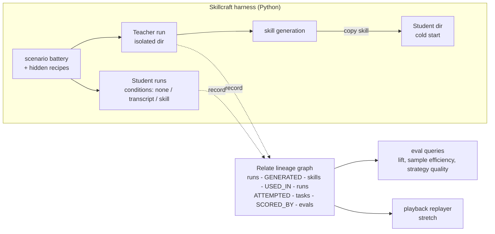

# Skillcraft — Project Brief

**Do models remember, transfer, or search? A crafting-table evaluation of skill distillation in teacher/student Mistral agent pairs.**

Skillcraft measures how AI agents acquire knowledge, using a Minecraft-inspired crafting table as a diagnostic instrument. Given a 3×3 crafting grid and an inventory of resources, Mistral agents craft target items through tool calls, with live visual feedback on every action: each placement or removal reports whether the current grid is craftable and what it would produce. Challenges come in three tiers — traditional (retrieval), derived (transfer), and invented (search) — and the experiment proper is skill distillation: a teacher agent solves invented-tier challenges, writes a portable skill file, and that skill is handed to a cold student agent judged on both taught and held-out tasks.

## Sequenced goals

1. **Core loop (must-have):** a crafting harness — craftable world model, tool-call interface (place / take / clear / craft), and validating feedback on every action.
2. **Scenario battery (must-have):** the three-tier challenge set — traditional, derived, invented — with a hidden ground-truth recipe book per scenario and grid-equivalence rules (rotation/mirror invariance) for validation.
3. **Distillation pipeline (must-have):** teacher agents solve invented scenarios, generate skill files; skills are copied into fresh directories; student agents run cold, with success, tool calls, failures, and wall time recorded.
4. **Conditions grid (must-have):** per tier, students run with (a) no aid, (b) raw teacher transcript, (c) distilled skill. The transcript condition is the proof that distillation beats copy-paste.
5. **Run provenance (should-have):** every run, derivation, and score recorded in Relate as a queryable lineage graph; fallback is JSON logs.
6. **Playback UI (stretch):** a mocked crafting table that replays any recorded run — inventory, resource placement, craft feedback — as a deterministic event-log replayer.

## Scenario design

| Tier | Example | Recipe source | What it isolates |
| --- | --- | --- | --- |
| Traditional | Craft a pickaxe | Canonical Minecraft recipes | Retrieval from training data |
| Derived | Craft a stool | Not in-game; plausible composition of real resources | Transfer from known recipes to related tasks |
| Invented | Craft a bar from quantities of foo, meh, fiz | Hidden, arbitrary, out-of-distribution | Search / in-context learning |

**Feedback contract (decided):** every `place` and `take` call returns whether the current grid is craftable and what item it would produce — honoring the Minecraft feedback loop, and making the invented tier a genuine search problem: with feedback, an agent can prune combinations strategy, not memorize answers.

**Validation:**
- Traditional: exact match against canonical recipes, with rotation/mirror equivalence.
- Derived: scored against a hidden acceptable-recipe set defined per scenario; partial credit for well-formed and plausible attempts.
- Invented: validated against the hidden recipe only; the teacher's route to it is exploration via feedback.

## Proposed tech stack

| Layer | Technology | Role |
| --- | --- | --- |
| Agents (teacher & student) | Mistral Vibe CLI, one-shot non-interactive runs in isolated directories | The subjects under test |
| Harness | Python orchestrator spawning Vibe runs, forking directories, copying skills | The experimenter |
| Skill medium | Skill files (Markdown env) generated by teacher, installed into student directories (`relate skill install --agent vibe` pattern) | The distilled knowledge |
| Lineage / eval store | Relate by Neo4j (embedded, single-binary; `relate-mistral` Vibe plugin / MCP) with JSON-log fallback | Run provenance, eval queries |
| Playback (stretch) | HTML/JS event-log replayer of the mocked crafting table, built via Vibe CLI | Judge-facing demo |
| Build-time assistant | Vibe CLI (interactive) | Scaffolding the harness, dataset, and UI during the event |

## Architecture

**Isolation principle:** every run gets a fresh directory, so no conversation or filesystem state leaks between teacher and student — students succeed by skill alone.

**Model graph (Relate):** `Task(recipe, tier)`, `Run(role, dir, condition, outcome, calls, duration)`, `Skill(content, hash, generation)`, `Eval(metric, value)`; edges: teacher `-GENERATED->` skill, skill `-USED_IN->` student, run `-ATTEMPTED->` task, run `-SCORED_BY->` eval. Sample efficiency, taught-vs-held-out splits, and skill-lift queries each reduce to single Cypher statements.

**Primary metrics (per tier × condition):**
- Success rate on taught tasks and on held-out tasks the teacher never saw
- Tool calls and failed attempts per successful craft
- Sample efficiency: student success vs. number of examples distilled into the skill
- Wall-clock time per run

## Judge-facing story

Open with "is it remembering, transferring, or searching?", replay a teacher search and a cold student success on the crafting-table UI, show the actual distilled skill file side by side with the teacher's transcript, close on the headline table of skill lift and sample efficiency. Full skill lineage — which run generated which skill, which students used it, what they scored — is queryable live in the Relate graph.
